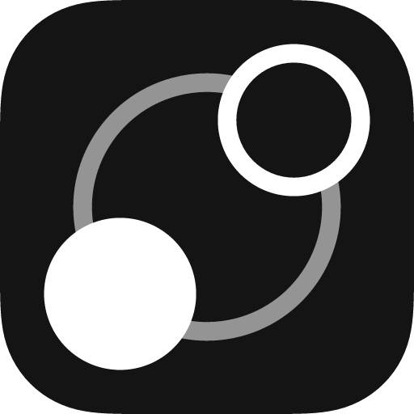

  

<h1 align="center">LearnHarness for Android</h1>

An unofficial, standalone Android adaptation of <a href="https://github.com/amosblomqvist/learnharness">LearnHarness</a>, created by <a href="https://github.com/amosblomqvist">Amos Blomqvist</a>.

The Android app packages LearnHarness's existing learning engine and interface in a native Android host. After installation, it runs on the phone without a computer or a remote LearnHarness server. Model features require internet access and a provider connection configured in Settings.

## Compatibility

- Android 13 or newer
- ARM64 (`arm64-v8a`) phones
- The app was tested on a Xiaomi 2411DRN47I running Android 16. Other devices have not been verified.

## What works

- Adaptive lessons, practice, chat history and the learning graph
- Provider sign-in, including a ChatGPT subscription connection
- Local file import and export through Android's document picker
- Interactive demo checks in a separate, restricted WebView
- Layouts adapted for narrow screens, with Android keyboard and Back navigation support

This adaptation adds no API-key billing or paid service. Your chosen provider may have its own account, subscription or usage terms. Records and provider connections are kept in the app's private storage; uninstalling the app erases them.

## Build and install

See [Android build and installation](docs/android.md) for Linux prerequisites, source setup, install steps and known limits. The current project provides a debug-signed direct-install build process; it is not a Play Store release.

## Upstream and credits

LearnHarness's learning engine, web interface and Android app icon come from the upstream project by **Amos Blomqvist**. This repository contains an independent Android adaptation maintained by **Vyas Devgna**. It is not an official release and is not endorsed by the upstream developer. See [CREDITS.md](CREDITS.md) and the [upstream repository](https://github.com/amosblomqvist/learnharness).

Showcase thread: [LearnHarness for Android on the upstream repository](https://github.com/amosblomqvist/learnharness/discussions/472).

## License

The source is distributed under the [GNU Affero General Public License v3.0](LICENSE), following the upstream project.
